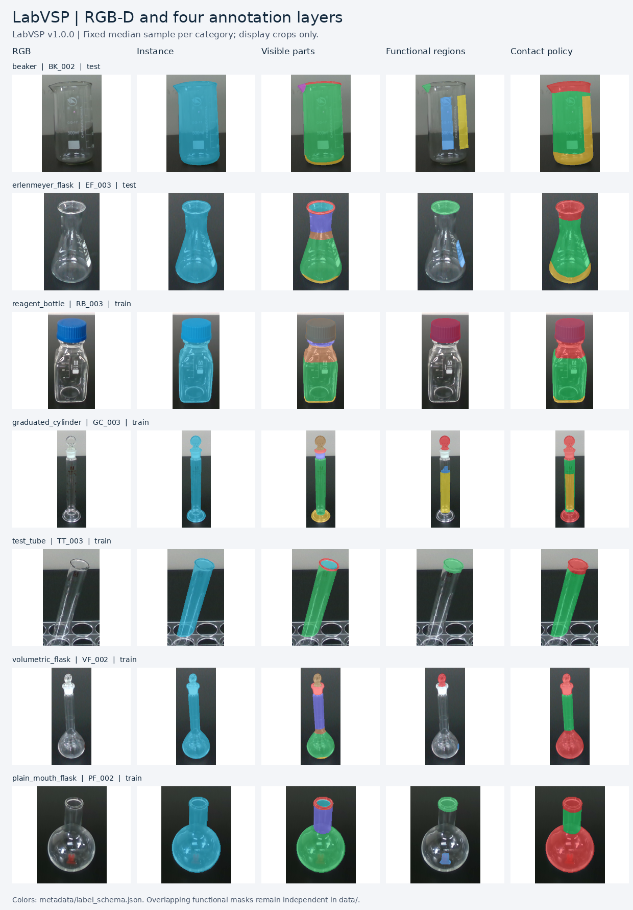

# LabVSP

**Version `1.0.0` (2026-10-29).** Data and annotations are provided under **CC BY-NC 4.0** for non-commercial use.

**Author:** Chengxuan Huang (黄程宣), PhD student in 周利锋课题组.  
**Team:** 南方科技大学工学院机械与能源工程系周利锋课题组.  
The team affiliation is retained in the confirmed Chinese form.

[中文说明](README.md) · [Repository](https://github.com/HCXMr/LabVSP) · [Issues / contact](https://github.com/HCXMr/LabVSP/issues) · [Citation](CITATION.cff)

LabVSP contains RGB-D observations of transparent laboratory vessels with **instance, visible-part, functional-region, and contact-policy annotations**. It reorganizes the existing LabGlass Visible-Only dataset using a frozen research inventory. The data content in `1.0.0` is unchanged from `0.1.0-draft`: image pixels, annotation arrays, physical-object identifiers, and split membership are preserved. This release updates publication materials, attribution, licensing, citations, and overview figures.


## Dataset at a glance

| Item | Count / description |
|---|---|
| Vessel categories / physical objects | 7 / 30 |
| RGB-D pairs | 356, all at 640 × 480 |
| Single-object / multi-object images | 331 / 25 |
| Annotated instances | 419: 331 single-object and 88 multi-object instances |
| Visible parts | 9 defined, 8 observed; no positive handle (`id=6`) pixels |
| Functional regions / contact policies | 4 / 3 |
| Full data payload | 9,741 files; 675,032,703 bytes (about 644 MiB) |

| Split | Images | Instances | Interpretation |
|---|---:|---:|---|
| train | 195 | 244 | 175 single-object images and 20 multi-object scenes |
| val | 81 | 81 | 7 validation objects |
| test | 75 | 75 | 7 development-held-out objects; used in development acceptance |
| multi_test | 5 | 19 | New layouts of previously seen objects |

The single-object train/val/test groups contain 16/7/7 disjoint physical objects. The test set is **not a pristine blind test**, and multi_test does **not** measure generalization to unseen physical objects. Views of the same physical object should not be randomly split across training and testing.



The detailed preview uses the middle single-object sample after sorting IDs within each category. Cropping is for display only. The two figures use separate display palettes: the overview legend applies to that figure only. Numeric IDs and names in [label_schema.json](metadata/label_schema.json) define the stored annotations; do not decode one figure with the other figure's color legend. Representative images are not a complete semantic audit.

## Download and use

The repository is [HCXMr/LabVSP](https://github.com/HCXMr/LabVSP). The fixed-version entry is [v1.0.0 Release](https://github.com/HCXMr/LabVSP/releases/tag/v1.0.0). Version assets are `LabVSP-v1.0.0-data.tar.gz`, `LabVSP-v1.0.0-repository.zip`, and `SHA256SUMS.txt`. See [distribution.json](metadata/distribution.json) for the actual distribution status and checksums.

The repository contains metadata, documentation, tools and a complete mini example. Full data reside in `data/`, distributed separately as a Release archive. The data archive also contains six licensing and citation files: `LICENSE.md`, `LICENSE-DATA.txt`, `LICENSE-CODE.md`, `NOTICE.md`, `CITATION.cff`, and `citation.bib`. Verify `SHA256SUMS.txt`, then extract the data archive at the repository root so that paths are `LabVSP/data/...`, not `data/data/...`.

Python 3.10+, NumPy and Pillow are required. Install `requirements.txt` in your own virtual environment if needed. The commands below read data without changing it:

```bash
python tools/load_sample.py --root examples/mini
python tools/load_sample.py --split train
python tools/validate_dataset.py
```

The last two commands require the full data archive. The loader reports array shapes; the validator reports `"status": "PASS"` when all checks pass.

The native entry point is `metadata/manifest.json`; paths are relative to the repository root. `metadata/images.jsonl` and `metadata/instances.jsonl` contain the image and instance records. Native binary masks, indexed PNGs, float32 NPY annotation-confidence maps, per-image camera metadata and optional COCO instance indexes are supplied. COCO segmentations use uncompressed column-major RLE; clients requiring compressed RLE can convert it with `pycocotools.mask.frPyObjects`. COCO indexes do not replace the native multilayer annotations.

## Interpretation and limitations

- Background is 0 and unknown is 255. Unknown labels must not be treated as background or allowed contact. Contact policies are allowed (1), discouraged (2), and forbidden (3).
- Labels describe visible evidence. They are not labels of hidden surfaces, and contact policy is not a physical grasp-success outcome. Annotation confidence indicates known human policy labels, not sensor confidence or grasp probability.
- Raw depth is 16-bit PNG with a declared scale of 0.001 m/unit and invalid value 0. It may be missing or wrong on transparent objects and is not independently measured transparent-surface ground truth.
- The integrity/structure check covers all 356 images, 419 instances and 9,741 payload files. Seven multi-object images contain eight overlapping instance-mask pairs; these are retained and documented.
- Twenty-eight objects have no dimensional measurements; the remaining two have partial measurements. Missing values remain `null`.
- Thirty objects and limited backgrounds, layouts and vessel categories constrain generalization claims. Class and part-pixel distributions are unbalanced. Structural checks and representative inspection do not establish complete semantic correctness or physical grasp success.
- Camera-model verification, acquisition setup and the full annotation protocol will be expanded with the manuscript. Existing intrinsics and timestamps are included.

See the Chinese [dataset card](docs/DATASET_CARD.md), [format documentation](docs/FORMAT.md), [release data validation](reports/release_validation.json), and [baseline audit from 2026-10-18](reports/检查报告.md).

## Citation and licensing

Please cite [CITATION.cff](CITATION.cff) or [citation.bib](citation.bib) and state version `1.0.0`. The associated manuscript is in preparation. No paper title, paper DOI or dataset DOI has yet been assigned in this record; do not substitute a placeholder DOI.

Data, annotations, associated dataset metadata, figures and dataset documentation are licensed under [CC BY-NC 4.0](https://creativecommons.org/licenses/by-nc/4.0/): non-commercial sharing and adaptation with attribution, a license link and an indication of changes. **Commercial use is not permitted by this license.** See [LICENSE.md](LICENSE.md) and [license scope](docs/LICENSE_STATUS.md).

Software in `tools/` and accompanying software examples are separately licensed under [PolyForm Noncommercial 1.0.0](LICENSE-CODE.md), which also restricts commercial use. Data and software licenses apply to their respective materials. Contact the maintainer through [Issues](https://github.com/HCXMr/LabVSP/issues).
