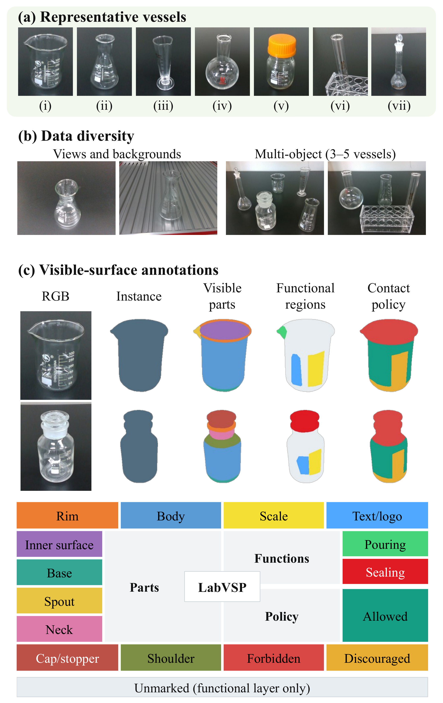

# LabVSP

LabVSP is an RGB-D dataset of transparent laboratory vessels for instance segmentation, part recognition, and contact-region prediction.

## Contents

- 7 vessel categories and 30 physical objects.
- 356 RGB-D image pairs at 640 × 480 resolution; 419 annotated instances.
- 331 single-object images and 25 multi-object images.
- Four annotation layers: instances, visible parts, functional regions, and contact policies (allowed, discouraged, forbidden).



## Structure

```text
data/           RGB, raw depth, camera metadata, and annotation masks
metadata/       Sample records, label definitions, object records, and COCO indexes
splits/         Train, validation, test, and multi-object test lists
examples/mini/  One sample with its annotations
tools/          Loading, validation, and export scripts
```

File formats and label IDs are described in [FORMAT.md](docs/FORMAT.md). Raw depth is sensor output, not surface ground truth. The test split was used during development; `multi_test` contains new layouts of previously seen objects. Further dataset notes are in the [dataset card](docs/DATASET_CARD.md).

## Download and use

Download these three files from the [v1.0.0 release](https://github.com/HCXMr/LabVSP/releases/tag/v1.0.0):

- `LabVSP-v1.0.0-repository.zip` — metadata, tools, and the example.
- `LabVSP-v1.0.0-data.tar.gz` — full data (135 MiB compressed).
- `SHA256SUMS.txt` — file checksums.

Place them in the same directory, then run:

```bash
sha256sum -c SHA256SUMS.txt
unzip LabVSP-v1.0.0-repository.zip
tar -xzf LabVSP-v1.0.0-data.tar.gz -C LabVSP
cd LabVSP
python -m pip install -r requirements.txt
python tools/load_sample.py --split train
python tools/validate_dataset.py
```

Python 3.10+ is required. To read the included example without the full data, run `python tools/load_sample.py --root examples/mini`.

## Paper

The associated paper has not yet been published. Journal details and the paper citation will be added after publication.

## License

Data and documentation: [CC BY-NC 4.0](LICENSE-DATA.txt). Tools: [PolyForm Noncommercial 1.0.0](LICENSE-CODE.md). Both restrict commercial use. See [LICENSE.md](LICENSE.md) for scope.
